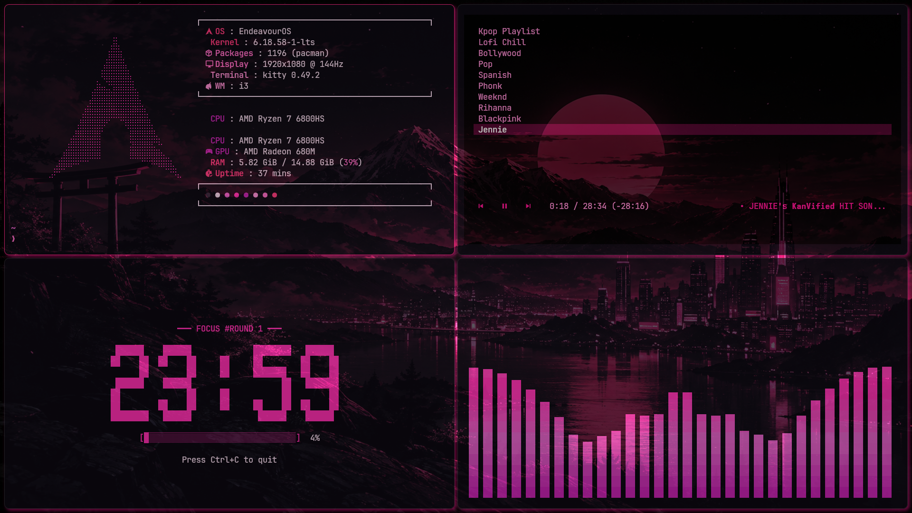
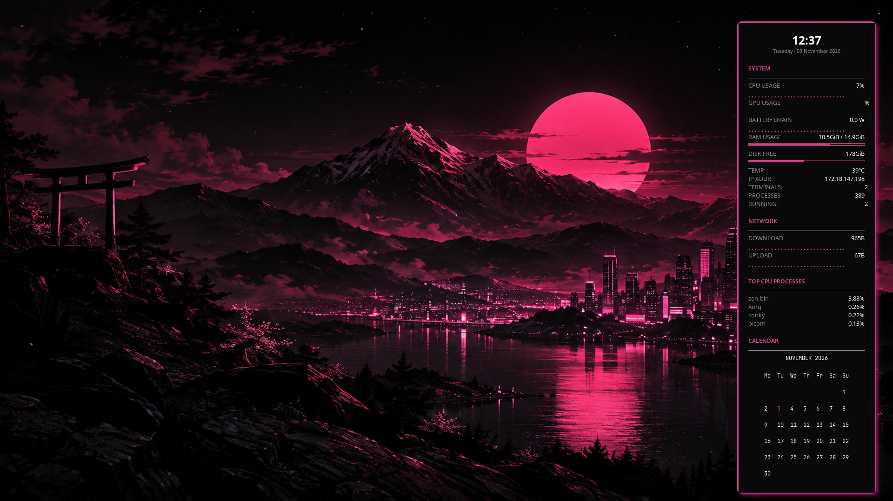

# Kathrina's Cyberpunk Rice

<p align="center">
  
  
  
  
  
</p>

A curated collection of my personal Linux configuration files, custom rice, scripts, and shell environments centered around an obsidian black and neon pink cyberpunk aesthetic on **EndeavourOS (i3wm)**.

---

## Screenshots

### Tiled Workspace (Kitty, Fastfetch, YT Music Player, Pomodoro & CAVA)


### Desktop & Conky System Monitor


---

## Rice Specifications & Components

| Component | Software | Details / Custom Features |
| :--- | :--- | :--- |
| **OS** | **EndeavourOS** | Linux 6.18 LTS kernel |
| **Window Manager** | **i3-wm** | Custom gaps, neon pink active borders (`#ff1493`), smart keybindings, multi-workspace routing |
| **Status Bar** | **Polybar** | Floating rounded pill layout (`radius: 14`), neon pink accents, interactive Wi-Fi & system menus, audio & workspace indicators |
| **App Launcher** | **Rofi** | Custom `neon-pink.rasi` theme, system powermenu, power-profiles switcher, keybinding helper & command runner |
| **Desktop Widget** | **Conky** | Neon pink framed sidebar showing real-time CPU/GPU loads, battery drain in Watts (`bat_watts.py`), Braille network graph (`braille_graph.py`), top processes & monthly calendar |
| **Terminal** | **Kitty** | `JetBrainsMono Nerd Font` (13pt), 95% opacity, beam cursor trail, custom neon pink color palette |
| **Compositor** | **Picom** | Dual-kawase background blur, rounded window corners, smooth fade transitions & neon drop shadows |
| **Visualizer** | **CAVA** | OpenGL shaders (`bar_spectrum`, `eye_of_phi`, `orion_circle`, `spectrogram`) styled with glowing pink gradients |
| **Music Player** | **ytplay** + **player.py** | CLI YouTube Music playlist player streaming high-bitrate audio via `mpv` with MPRIS & Polybar integration |
| **Productivity** | **Pomodoro** + **Todo** | Custom Python Pomodoro timer (`pomo.py`) featuring large ASCII digital clock & progress bar, plus custom todo CLI |
| **Notifications** | **Dunst** | Notification popups matched to the black & neon pink theme |
| **System Info** | **Fastfetch** / **Neofetch** | Clean system hardware & OS breakdown with EndeavourOS / Arch ASCII logo |
| **Editor** | **Micro** | Modern terminal editor with custom `pink.micro` syntax theme & keybindings |
| **Theming** | **GTK 3/4** | Arc-Dark base with custom `gtk.css` neon pink highlights, `Qogir-Dark` cursor & icon set, `nwg-look` |
| **Wallpaper** | **feh** | Cyberpunk Mount Fuji & neon Torii gate (`wallpaper.png`) |

---

## Custom Scripts & Tools

- **`ytplay <query>`**: Shell function (`.zshrc` / `.bashrc`) to search YouTube, stream audio with `mpv`, and integrate with MPRIS.
- **`pomo.py`**: Interactive CLI Pomodoro focus timer with visual rounds, animated ASCII clock, and completion sound/notifications.
- **`command-menu.sh`**: Rofi launcher module for rapid system administration, service inspection, and custom shortcuts.
- **`wifi-menu.sh`**: Polybar-integrated Wi-Fi scanner and connection prompt through Rofi.
- **`bat_watts.py` & `braille_graph.py`**: Real-time Conky helpers for battery power draw calculations and dynamic terminal Braille graphs.
- **`sync.sh`**: Keeps this repository up to date with your live system while automatically stripping private credentials.
- **`restore.sh`**: Re-applies configs safely with automated backup creation if you need to recover from a configuration mishap.

---

## Repository Structure

```
dotfiles/
├── .config/
│   ├── autostart/             # Autostart desktop entries
│   ├── btop/                  # Resource monitor config & themes
│   ├── cava/                  # Audio visualizer config, themes & shaders
│   ├── conky/                 # Conky system stats, graphs & calendar widgets
│   ├── dunst/                 # Notification daemon styling
│   ├── fastfetch/             # System information display
│   ├── gtk-3.0/ & gtk-4.0/    # GTK styling & theme configurations
│   ├── i3/                    # Window manager config, keybindings & scripts
│   ├── kitty/                 # Kitty terminal config & color scheme
│   ├── Kitty-Efeckt/          # Terminal ASCII art banner
│   ├── micro/                 # Micro editor bindings, theme & settings
│   ├── neofetch/              # Neofetch configuration
│   ├── nwg-look/              # GTK theme switcher config
│   ├── picom/                 # Picom compositor / blur / shadows
│   ├── polybar/               # Polybar status bar config & interactive scripts
│   ├── pomodoro/              # CLI Pomodoro focus timer (pomo.py)
│   ├── rofi/                  # App launcher, power menu, themes & scripts
│   ├── todo/                  # Python todo manager app (with tasks.json.example)
│   ├── xsettingsd/            # X11 settings daemon
│   └── *.toml, *.conf, *.ini  # greenclip, libinput-gestures, pavucontrol, QtProject
├── .bashrc                    # Bash shell configuration (with Starship)
├── .bash_profile              # Login shell profile
├── .zshrc                     # Zsh shell configuration (ytplay & aliases)
├── .fehbg                     # Wallpaper restore script
├── .Xresources                # X11 resources (cursor size/theme)
├── .gitconfig                 # Git user configuration
├── .gtkrc-2.0                 # GTK2 appearance settings
├── .inputrc                   # Readline input config
├── .profile                   # Environment variables
├── .taskrc                    # Taskwarrior config
├── screenshot.png             # Tiled showcase screenshot
├── screenshot-desktop.png     # Clean desktop with Conky screenshot
├── wallpaper.png              # System wallpaper
├── sync.sh                    # Helper script to sync live changes into this repo
├── restore.sh                 # Helper script to restore configs if a blunder occurs
└── .gitignore                 # Excludes secrets, caches, and machine-specific data
```

---

## Usage

### 1. Synchronizing Tweaks to Git
Whenever you adjust your i3 layout, polybar, or kitty configs:
```bash
cd ~/projects/dotfiles
./sync.sh
git diff
git commit -am "chore: update config tweaks"
git push origin main
```

### 2. Recovering from a Blunder
If an experimental tweak breaks your desktop or terminal:
```bash
cd ~/projects/dotfiles
./restore.sh
```
*(You will be prompted to create an automatic timestamped backup of your current setup before files are restored.)*
